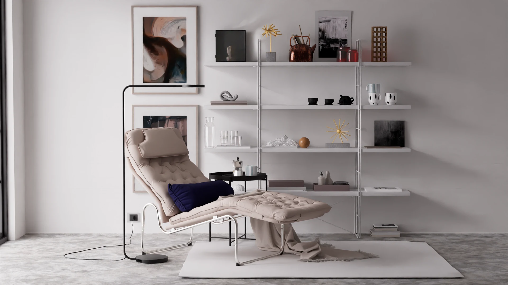

<div align="center">


# MuTracer

**Physically based path tracing in the browser.**

WebGPU first with a WebGL 2 fallback · OpenPBR 1.1 materials · MaterialX node graphs · OIDN denoising

[](https://www.npmjs.com/package/@meimu/mutracer)
[](./LICENSE)

**[Open the viewer](https://mutracer.meimu-studio.com/viewer/)** ·
[Website](https://mutracer.meimu-studio.com/) ·
[Docs](./docs) ·
[Examples](https://mutracer.meimu-studio.com/examples/) ·
[Changelog](./CHANGELOG.md)

<a href="https://mutracer.meimu-studio.com/"></a>

<sub><a href="https://github.com/mmp/pbrt-v4-scenes#kroken">Kroken</a> by Angelo Ferretti, <a href="https://creativecommons.org/licenses/by-nd/2.0/">CC BY-ND 2.0</a> · rendered in MuTracer</sub>

</div>

## Quick start

```bash
npm install @meimu/mutracer three
```

Keep building your scene with Three.js; `THREESync` converts it once and follows
transform, material and light edits on every frame.

```ts
import { Engine, RenderLoop } from '@meimu/mutracer';
import { THREESync } from '@meimu/mutracer/three';

const engine = new Engine({ canvas });
const sync = new THREESync(engine, { scene, camera, controls });
const loop = new RenderLoop(engine, { sync });
loop.start();

loop.final.setDenoiser({ type: 'oidn' }); // denoise the converged frame (WebGPU)
```

The [getting started guide](./docs/getting-started.md) covers the scene model, render loop,
lights and export; the [Three.js guide](./docs/threejs.md) covers loading glTF.

## Highlights

- **Light transport.** Progressive unidirectional path tracing with next-event estimation and MIS over rect, disk, cylinder, sphere, IES spot, directional and HDR environment lights. Continuous-wavelength dispersion. [Caustics](./docs/caustics.md) on WebGPU.
- **Materials.** The [OpenPBR 1.1](./docs/materials.md) surface: F82 metals, anisotropic specular and coat, fuzz, thin film, dispersive transmission with volume scattering, subsurface scattering and displacement. Drive any input from [material graphs](./docs/material-graphs.md) or [MaterialX documents](./docs/materialx.md).
- **Large scenes.** Two-level BVH with binned-SAH BLASes built in parallel Workers (JavaScript or TinyBVH WebAssembly). Moving instances only refits the TLAS; new meshes upload only their geometry. See [performance](#performance).
- **Clean images.** Owen-scrambled Sobol or blue-noise ZSobol samples, variance-driven adaptive sampling, and albedo- and normal-guided [denoising](./docs/denoising.md) with Intel OIDN (WebGPU) or JNLM (both backends).
- **Output.** Deterministic `converge()`, AgX, ACES and other tone mappers, bloom, thin-lens depth of field, shadow catchers, transparent backgrounds, AOVs, HDR output and PNG export.
- **Integration.** Incremental [Three.js sync](./docs/threejs.md), your own `GPUDevice`, OffscreenCanvas workers and display [post-processing passes](./docs/post-processing.md). Without WebGPU, the same code renders on WebGL 2.

## New in 0.4

- **Material graphs**: drive OpenPBR inputs from a [`MaterialGraph`](./docs/material-graphs.md)
  of MaterialX nodes. WebGPU compiles procedural graphs; both backends render image graphs.
- **MaterialX import**: [`parseMaterialX`](./docs/materialx.md) from `@meimu/mutracer/materialx`.
  The viewer ships 55 procedural samples and browses the GPUOpen MaterialX Library.
- **Instant material edits** with [`shaderPrefetch: 'editing'`](./docs/updates.md#editing-prefetch).
- [`UdimTexture`](./docs/materials.md#udim-textures), [`DiskLight` and `CylinderLight`](./docs/getting-started.md#lights),
  pixel-center [AOVs](./docs/api.md#surface-outputs), [`mesh.visible`](./docs/updates.md#visibility)
  and incremental geometry uploads.
- **Breaking:** import the Three.js adapter from `@meimu/mutracer/three`.

See the [changelog](./CHANGELOG.md) for the full list.

## Gallery

Click a preview to path trace the scene in the browser.

### MuTracer Collection

<table>
  <tr>
    <td width="25%" valign="top">
      <a href="https://mutracer.meimu-studio.com/viewer/#model=porsche-992-gt3-r"></a><br />
      Porsche 992 GT3 R<br />
      <sub><a href="https://sketchfab.com/3d-models/2024-porsche-992-gt3-r-b76c9b2ae2d548c3869426eac4ab8a19">Dave</a> · <a href="https://creativecommons.org/licenses/by/4.0/">CC BY 4.0</a></sub>
    </td>
    <td width="25%" valign="top">
      <a href="https://mutracer.meimu-studio.com/viewer/#model=super-human"></a><br />
      Super Human<br />
      <sub><a href="https://sketchfab.com/3d-models/super-human-7aa58e978b9f4357b8e73d8e0440c896">Davyd Vidiger</a> · <a href="https://creativecommons.org/licenses/by/4.0/">CC BY 4.0</a></sub>
    </td>
    <td width="25%" valign="top">
      <a href="https://mutracer.meimu-studio.com/viewer/#model=fluted-crystal"></a><br />
      Fluted Crystal<br />
      <sub><a href="https://github.com/pissang/mutracer-assets">Yi Shen</a> · <a href="https://creativecommons.org/publicdomain/zero/1.0/">CC0</a></sub>
    </td>
    <td width="25%" valign="top">
      <a href="https://mutracer.meimu-studio.com/viewer/#model=blender-cover-remix"></a><br />
      Blender Cover Remix<br />
      <sub><a href="https://sketchfab.com/3d-models/blender-cover-remix-a38f11890ff141c88fcdac6b637fdaf8">bandinopla</a> · <a href="https://creativecommons.org/licenses/by/4.0/">CC BY 4.0</a></sub>
    </td>
  </tr>
</table>

### glTF Research Scenes

Reference previews and glTF conversions by [ErfanMo77](https://github.com/ErfanMo77/gltf-research-scenes).

<table>
  <tr>
    <td width="25%" valign="top">
      <a href="https://mutracer.meimu-studio.com/viewer/#model=research-breakfast-room"></a><br />
      Breakfast Room<br />
      <sub><a href="https://github.com/ErfanMo77/gltf-research-scenes/tree/main/scenes/breakfast-room">Wig42</a> · <a href="https://github.com/ErfanMo77/gltf-research-scenes/blob/main/scenes/breakfast-room/source/LICENSE.txt">CC BY 3.0</a></sub>
    </td>
    <td width="25%" valign="top">
      <a href="https://mutracer.meimu-studio.com/viewer/#model=research-bathroom2"></a><br />
      Bathroom 2<br />
      <sub><a href="https://github.com/ErfanMo77/gltf-research-scenes/tree/main/scenes/bathroom2">nacimus</a> · <a href="https://github.com/ErfanMo77/gltf-research-scenes/blob/main/scenes/bathroom2/source/LICENSE.txt">CC BY 3.0</a></sub>
    </td>
    <td width="25%" valign="top">
      <a href="https://mutracer.meimu-studio.com/viewer/#model=research-classroom2"></a><br />
      Classroom 2<br />
      <sub><a href="https://github.com/ErfanMo77/gltf-research-scenes/tree/main/scenes/classroom2">Christophe Seux</a> · <a href="https://github.com/ErfanMo77/gltf-research-scenes/blob/main/scenes/classroom2/source/LICENSE.txt">CC0</a></sub>
    </td>
    <td width="25%" valign="top">
      <a href="https://mutracer.meimu-studio.com/viewer/#model=research-living-room"></a><br />
      Living Room<br />
      <sub><a href="https://github.com/ErfanMo77/gltf-research-scenes/tree/main/scenes/living-room">Wig42</a> · <a href="https://github.com/ErfanMo77/gltf-research-scenes/blob/main/scenes/living-room/source/LICENSE.txt">CC BY 3.0</a></sub>
    </td>
  </tr>
  <tr>
    <td width="25%" valign="top">
      <a href="https://mutracer.meimu-studio.com/viewer/#model=research-house"></a><br />
      House<br />
      <sub><a href="https://github.com/ErfanMo77/gltf-research-scenes/tree/main/scenes/house">Benedikt Bitterli</a> · <a href="https://github.com/ErfanMo77/gltf-research-scenes/blob/main/scenes/house/source/LICENSE.txt">CC0</a></sub>
    </td>
    <td width="25%" valign="top">
      <a href="https://mutracer.meimu-studio.com/viewer/#model=research-glass-of-water"></a><br />
      Glass of Water<br />
      <sub><a href="https://github.com/ErfanMo77/gltf-research-scenes/tree/main/scenes/glass-of-water">aXel</a> · <a href="https://github.com/ErfanMo77/gltf-research-scenes/blob/main/scenes/glass-of-water/source/LICENSE.txt">CC0</a></sub>
    </td>
    <td width="25%" valign="top">
      <a href="https://mutracer.meimu-studio.com/viewer/#model=research-spaceship"></a><br />
      Spaceship<br />
      <sub><a href="https://github.com/ErfanMo77/gltf-research-scenes/tree/main/scenes/spaceship">thecali</a> · <a href="https://github.com/ErfanMo77/gltf-research-scenes/blob/main/scenes/spaceship/source/LICENSE.txt">CC0</a></sub>
    </td>
    <td width="25%" valign="top">
      <a href="https://mutracer.meimu-studio.com/viewer/#model=research-veach-mis"></a><br />
      Veach MIS<br />
      <sub><a href="https://github.com/ErfanMo77/gltf-research-scenes/tree/main/scenes/veach-mis">Eric Veach / Benedikt Bitterli</a> · <a href="https://github.com/ErfanMo77/gltf-research-scenes/blob/main/scenes/veach-mis/source/LICENSE.txt">CC0</a></sub>
    </td>
  </tr>
</table>

## Performance

<a href="https://mutracer.meimu-studio.com/viewer/#model=bugatti-chiron"></a>

The [LEGO Technic Bugatti Chiron](https://mutracer.meimu-studio.com/viewer/#model=bugatti-chiron)
(<a href="https://sketchfab.com/3d-models/lego-technic-bugatti-chiron-c2a54e2e979a4905b859c1533b498221">VTX</a>, CC-BY-NC-SA 4.0)
is a heavy scene that path traces interactively in the viewer:

| | Bugatti Chiron |
| --- | --- |
| Rendered triangles | 4.6 M (2.5 M unique, 341 geometries in 560 meshes) |
| Materials | 35 |
| Download | 12.8 MB `.glb` |
| BVH build, 1 thread | 1.7 s (built-in builder) / 1.0 s (TinyBVH WebAssembly) |
| BVH build, 4 workers (default) | 0.50 s (built-in builder) / 0.28 s (TinyBVH WebAssembly) |
| 1920 × 1080, 64 spp | 12.1 s path tracing, 12.4 s with OIDN denoising |

Measured on an Apple M4 Max: rendering in Chrome with WebGPU at the viewer's
default settings (6 bounces), BVH builds on CPU threads excluding worker startup.

## Packages

| Import | Contents |
| --- | --- |
| `@meimu/mutracer` | Engine, renders, display, scene classes, material graphs |
| `@meimu/mutracer/three` | `THREESync` and Three.js scene conversion; needs `three` (and `@types/three` for TypeScript) |
| `@meimu/mutracer/materialx` | `parseMaterialX` |
| `@meimu/mutracer/oidn` | OIDN weight helpers |

The package is ESM with TypeScript declarations. A UMD build with a `MuTracer`
global is at `dist/mutracer.umd.js`; deploy its `dist/assets/` alongside it. See
[loading and deployment](./docs/getting-started.md#loading-and-deployment).

**Browsers:** WebGPU (current Chrome, Edge and Safari) is recommended and required
for OIDN, caustics, HDR output and options marked WebGPU in the
[API reference](./docs/api.md). The WebGL 2 fallback needs `EXT_color_buffer_float`.
The first frame compiles large shaders, which can take several seconds.

## Documentation

| Guide | Contents |
| --- | --- |
| [Getting started](./docs/getting-started.md) | Scene model, render loop, lights, export, workers, your own `GPUDevice` |
| [Scene updates](./docs/updates.md) | Editing a rendering scene, animation, visibility, update costs |
| [API reference](./docs/api.md) | Engine, Display and Render options, methods and scene types |
| [Materials](./docs/materials.md) | OpenPBR inputs, textures, UDIM, alpha, bevel, displacement |
| [Material graphs](./docs/material-graphs.md) | Procedural and image node graphs on OpenPBR |
| [MaterialX](./docs/materialx.md) | Parsing `.mtlx` documents |
| [Three.js](./docs/threejs.md) | `THREESync`, supported materials and lights, `userData` keys |
| [Progressive rendering](./docs/progressive-rendering.md) | Independent renders, sample batching, fallbacks |
| [Caustics](./docs/caustics.md) | Light tracing and photon mapping (WebGPU) |
| [Denoising](./docs/denoising.md) | JNLM and OIDN denoisers, OIDN weights hosting |
| [Post-processing](./docs/post-processing.md) | Display passes, GPU output textures, upscaling |
| [Sampling](./docs/sampling.md) | Patterns, dimensions and progressive budgets |
| [BVH](./docs/bvh.md) | BVH builders, TinyBVH layouts, worker preparation |
| [Performance](./docs/performance.md) | Tuning checklist |
| [Viewer](./docs/viewer.md) | Using the online viewer, MaterialX import, shareable links |
| [`llms.txt`](./llms.txt) | Compact usage guide for coding agents |

Run the [examples](./examples) locally with `npm install` and `npm run dev`.

## Contributing

Pull requests are not accepted at the moment; please open an
[issue](https://github.com/pissang/mutracer/issues) instead. See
[CONTRIBUTING.md](./CONTRIBUTING.md) for development setup, required checks
and GPU validation.

## License

MuTracer is released under the [MIT License](./LICENSE). It includes third-party
code and data under MIT, Apache-2.0 and CC0 licenses; see
[THIRD_PARTY_NOTICES.md](./THIRD_PARTY_NOTICES.md). Gallery models keep their
own licenses, linked under each image.
